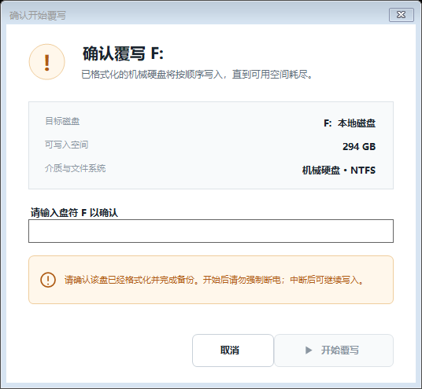
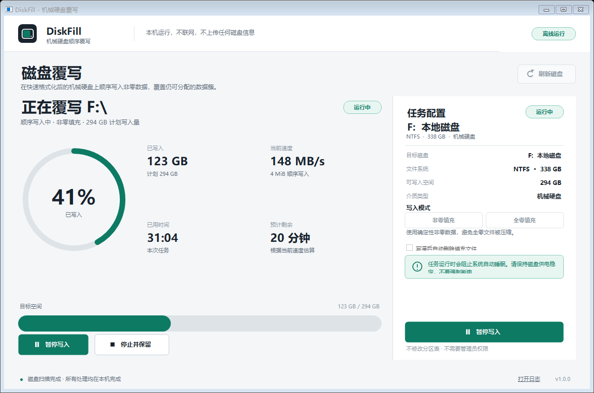

# DiskFill

面向机械硬盘的快速空间覆写工具。用于快速格式化后的机械硬盘，通过顺序写入非零数据尽可能覆盖可分配簇，降低已删除文件被恢复的机会。


## 为什么使用 DiskFill

机械硬盘执行快速格式化时，通常只重建文件系统索引，盘片上的旧数据可能仍然存在，直到相应区域被新数据覆盖。DiskFill 的目标不是删除文件，而是用顺序写入的新数据占满格式化后的可分配空间。

- 顺序写入，适合机械硬盘的磁头与缓存特性。
- 不需要管理员权限，不直接访问裸盘，不修改分区表。
- 自动识别并保护系统盘、程序所在盘和固态硬盘。
- 支持暂停、继续、异常中断恢复和任务清理。
- 运行时没有第三方运行库依赖，目标框架为 `.NET Framework 4.8`。

## 重要边界

DiskFill 是**文件系统级空间填充工具**，不是认证级磁盘擦除器。

- 它只能覆盖文件系统允许普通文件使用的簇。
- 文件系统元数据、保留区、坏扇区、厂商保留区不会被文件写入覆盖。
- SSD 不应使用此工具做安全擦除，应使用厂商工具执行 `Secure Erase` 或 `Sanitize`。
- 如果磁盘中还保留着需要的数据，填满空闲空间不能“擦除已有文件”。
- 对合规或高威胁场景，请使用 ATA Secure Erase、厂商安全擦除工具或符合相应标准的专业方案。

对普通机械硬盘的常规复用场景，一次全空间覆写已经可以显著降低快速格式化后数据恢复的可能性。多轮覆写通常不会比单轮带来线性增长的收益。

## 使用条件

- Windows 10 或 Windows 11。
- 已启用 `.NET Framework 4.8`。Windows 10 1903 及更高版本和 Windows 11 默认包含。
- 目标为本地机械硬盘，卷已格式化并已挂载。
- 目标卷不是系统盘、程序所在盘或当前工作目录所在盘。
- 建议至少保留 `64 MB` 可用空间，否则程序会拒绝创建任务。

## 使用步骤

1. 备份并确认目标盘中没有需要保留的数据。
2. 对机械硬盘执行快速格式化，挂载后启动 DiskFill。
3. 在磁盘列表中选择目标盘，确认介质显示为“机械硬盘”。
4. 选择“非零填充”或“全零填充”。默认推荐非零填充。
5. 点击“开始覆写”，输入盘符完成二次确认。
6. 等待可用空间耗尽。可以暂停、继续或停止任务。
7. 完成后可选择删除填充文件。删除文件只释放空间，不会撤销已完成的覆盖。





## 恢复与清理

任务状态保存在目标卷根目录的隐藏目录 `.diskfill` 中：

```text
.diskfill/
  session.json
  part-000001.bin
  part-000002.bin
```

程序异常退出后，下次启动会识别未完成任务并从现有文件末尾继续。清理操作只删除上述目录中的 DiskFill 分段文件和任务清单；无法识别的其他文件不会被删除。

## 实现原理

DiskFill 通过普通的 `FileStream` 在目标卷上创建分段文件，使用 `4 MiB` 写入块持续顺序写入，直到系统返回磁盘已满或达到任务初始可用空间：

1. 通过 `DriveInfo` 枚举本地卷。
2. 使用 `IOCTL_STORAGE_QUERY_PROPERTY / StorageDeviceSeekPenaltyProperty` 判断介质是否具有寻道代价，从而区分机械硬盘与固态硬盘。
3. 使用卷序列号和卷容量建立任务身份，防止错误续写。
4. 默认写入确定性非零数据，避免全零文件被压缩卷或去重机制轻易压缩。
5. FAT32 卷自动使用接近 `4 GiB` 的分片，其他文件系统使用更大的顺序分片。
6. 捕获 `ERROR_DISK_FULL` 和 `ERROR_HANDLE_DISK_FULL` 作为正常完成条件。
7. 每隔约 `220 ms` 更新速度、写入量、耗时和 ETA；界面线程不执行磁盘 I/O。

更完整的设计说明见 [docs/ARCHITECTURE.md](docs/ARCHITECTURE.md)。

## 性能

- 机械硬盘的瓶颈几乎总是磁头和盘片，而不是 CPU。
- 使用大块顺序写入，避免小文件和随机写。
- 关闭不必要的强制刷盘，只有分段结束和任务结束才执行 `Flush(true)`。
- 默认不启用多线程并发写。对机械硬盘来说，额外的随机竞争通常只会降低吞吐。
- 实际速度取决于接口、转速、缓存、USB 桥接芯片、文件系统和写入位置。

## 构建

需要 Visual Studio 2022 的 **.NET 桌面开发** 工作负载，并安装 **.NET Framework 4.8 targeting pack**。

```powershell
dotnet restore .\DiskFill.sln
dotnet build .\DiskFill.sln -c Release
dotnet test .\DiskFill.sln -c Release
```

生成发布包：

```powershell
.\build.ps1
```

或手动发布：

```powershell
dotnet publish .\DiskFill\DiskFill.csproj -c Release -f net48 -o .\publish
```

发布结果包含 `DiskFill.exe` 和必要的 `.exe.config`，不包含第三方运行库。目标机器只需要自带的 `.NET Framework 4.8`。

本地构建产物默认没有商业代码签名，首次运行时 Windows SmartScreen 可能提示未知发布者。发布前应自行签名，并核对构建来源与 SHA-256。

项目同时提供 `DiskFill.sln` 和较新的 `DiskFill.slnx`。常规 Visual Studio 和 GitHub Actions 使用 `.sln`。

## 项目结构

```text
DiskFill/
  Core/
    Infrastructure/   本机 API、日志、格式化和执行状态
    Models/           磁盘、任务、进度和结果模型
    Services/         磁盘扫描、任务存储和写入引擎
  UI/
    Controls/         自绘按钮、磁盘卡片、进度环和提示条
    Dialogs/          覆写确认对话框
    MainForm.cs       界面状态机与交互编排
DiskFill.Tests/       无真实磁盘依赖的回归测试
docs/                 架构和安全边界文档
tools/                图标生成与界面离屏预览工具
```

## 测试

```powershell
dotnet test .\DiskFill.sln -c Release
```

测试覆盖数据模式、格式化、分片策略、任务兼容性、系统盘保护、断点追加、跨分片写入和磁盘满错误识别。测试只写入系统临时目录，不会对真实磁盘执行覆写。

界面预览工具可生成主界面、运行态、完成态和确认对话框截图：

```powershell
dotnet run --project .\tools\PreviewRenderer\PreviewRenderer.csproj -c Debug -- .\artifacts
```

## 隐私

- 不联网，不包含遥测或自动更新。
- 不读取文件内容，只创建并顺序写入 DiskFill 自己的分段文件。
- 本地日志位于 `%LOCALAPPDATA%\DiskFill\logs`，不会上传。

## 开源协议

[MIT](LICENSE)
