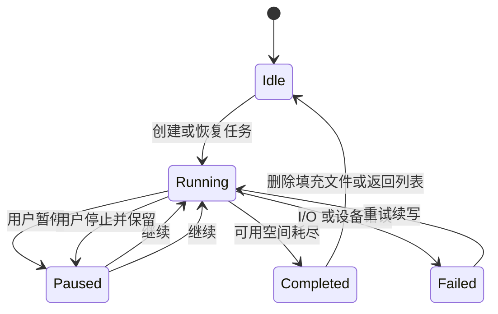

# DiskFill 架构说明

## 目标

DiskFill 的核心目标是：在不修改分区表和文件系统的前提下，用尽可能稳定的顺序写入覆盖格式化后机械硬盘的可分配空间，并允许长时间任务中断后恢复。

设计优先级依次为：

1. 不误写系统盘或非目标卷。
2. 写入过程可暂停、可停止、可恢复。
3. 对机械硬盘保持高顺序吞吐。
4. UI 与磁盘 I/O 解耦，长任务不冻结界面。
5. 运行时零第三方依赖，兼容系统自带的 `.NET Framework 4.8`。

## 分层

```text
UI
  MainForm / Controls / Dialogs
        |
        v
Core.Services
  DriveService / JobStore / FillEngine / SystemVolumeGuard
        |
        v
Core.Infrastructure
  NativeMethods / AppLog / PauseController / Formatters
```

UI 只负责选择和展示状态，不直接写文件。`FillEngine.RunAsync` 在后台完成所有 I/O，通过 `IProgress<FillProgress>` 把节流后的进度送回 UI。

## 卷发现与安全判定

`DriveService` 只枚举 `DriveType.Fixed` 和 `DriveType.Removable` 的已就绪卷。

介质类型通过 `DeviceIoControl` 查询：

```text
IOCTL_STORAGE_QUERY_PROPERTY
  StorageDeviceSeekPenaltyProperty
```

如果设备存在寻道代价，则标记为机械硬盘。没有寻道代价的设备标记为固态硬盘并禁止开始任务。部分 USB 桥接芯片可能不提供可靠信息，此时显示“介质类型未知”，由用户确认。

`SystemVolumeGuard` 会拒绝以下卷：

- `%SystemDirectory%` 所在卷。
- Windows 目录所在卷。
- 应用程序目录所在卷。
- 当前工作目录所在卷。

此外，可用空间低于 `64 MiB` 的卷不能创建新任务。

## 写入模型

文件系统层写入路径：

```text
Drive:\\.diskfill\part-000001.bin
                         part-000002.bin
                         ...
```

单个分片的目标长度由文件系统决定：

| 文件系统 | 分片长度 |
| --- | --- |
| FAT32 | `4 GiB - 1 MiB` |
| 其他 | `16 GiB` |

写入循环的核心不变量：

```text
absolute_offset = sum(length of all existing part files)
written_bytes   = sum(length of all existing part files)
```

恢复时不需要完全信任清单中的进度。程序以分段文件的实际长度为准，因此即使进程在清单刷新前崩溃，也不会重复写过或跳过数据。

每个 `4 MiB` 缓冲区的数据由绝对偏移决定，所以中断后重新生成相同位置的数据仍然保持一致。

## 完成与错误

以下情况视为完成：

- 写入到任务创建时记录的可用空间。
- Windows 返回 `ERROR_DISK_FULL` 或 `ERROR_HANDLE_DISK_FULL`。

以下情况视为暂停或失败：

- 用户取消。
- 设备断开。
- 权限、I/O、文件系统或硬件错误。

磁盘满错误被单独识别，因为任务的目标就是尽可能耗尽可用空间，这不是异常失败。

## 任务状态

任务清单为 DataContract JSON，包含：

- Schema 版本。
- 随机任务 ID。
- 卷根路径、序列号和容量。
- 文件系统、写入模式、计划写入量和分片长度。
- 当前状态、最后已知写入量和更新时间。

运行时路径不写入清单，始终由当前卷根目录重新构造，避免清单被篡改后访问其他目录。

兼容性要求：

- 卷序列号一致。
- 卷总容量一致。
- Schema 版本一致。

不兼容时只显示错误，不自动覆盖或清理。

## 清理边界

清理操作硬编码在卷根目录的 `.diskfill` 目录内，并执行以下检查：

1. 规范化目标路径。
2. 确认路径等于当前卷的 `.diskfill` 目录。
3. 如果目录是重解析点，拒绝删除。
4. 只删除 `part-*.bin`、`session.json` 和临时清单。
5. 不递归删除无法识别的文件。

## 线程与取消

- `FillEngine` 使用异步 `FileStream.WriteAsync`。
- 取消令牌在每次写入块前检查。
- 暂停使用 `ManualResetEventSlim` 包装的 `PauseController`。
- 任务运行期间调用 `SetThreadExecutionState`，避免系统自动睡眠。
- UI 进度报告限制在约 `220 ms` 一次，防止消息队列被高频进度淹没。

## 状态机



## 已知限制

- 文件级写入无法覆盖文件系统保留区和物理坏扇区。
- 设备管理器、文件系统和 USB 桥接芯片可能对介质类型判断产生影响。
- 文件系统压缩、稀疏文件和去重可能改变实际落盘行为；默认非零模式用于降低压缩影响。
- 任务清单写入在磁盘接近全满时可能失败，但分段文件实际长度仍是恢复依据。
- 程序不运行时无法监控设备变化；开始前会重新校验卷身份。

## 测试策略

自动化测试不访问真实目标盘。写入引擎测试使用系统临时目录，并验证：

- 非零和全零数据模式。
- 偏移确定性和分片顺序。
- 跨分片写入。
- 已有分段文件的断点追加。
- FAT32 与 NTFS 分片大小。
- Windows 磁盘满错误码。
- 系统盘保护与卷兼容性。

界面通过 `tools/PreviewRenderer` 生成离屏截图，覆盖主界面、最小窗口、运行态、完成态和确认对话框。
